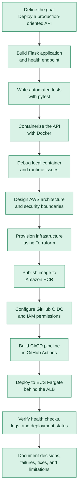
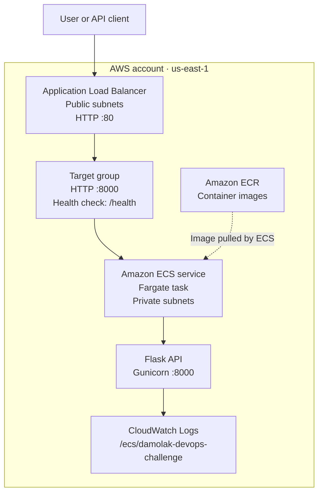
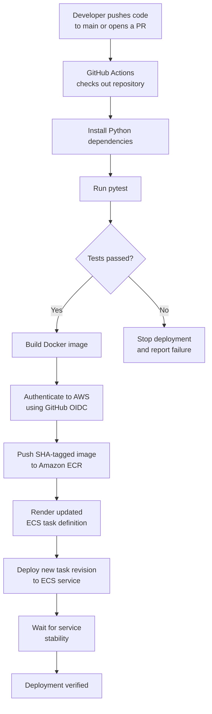

# Damolak DevOps Challenge: Production-Oriented Application Deployment

**An end-to-end DevOps project using Docker, Terraform, AWS ECS Fargate, Amazon ECR, GitHub Actions, and OpenID Connect (OIDC).**

## Project Overview

This project demonstrates how to take a simple Flask API from local development to a containerized application deployed on AWS, with infrastructure provisioned through Terraform and application deployment automated through GitHub Actions.

The objective was not simply to make an API run. It was to build a repeatable deployment process that incorporates automated testing, Infrastructure as Code (IaC), containerization, network isolation, identity-based access to AWS, application health checks, centralized logging, and deployment verification.

The project was developed as part of the **Damolak DevOps Engineer Practical Challenge: Production-Ready Application Deployment**.

### Key outcomes

- Built a Flask API with root and health-check endpoints.
- Added automated tests using pytest.
- Created a Docker image using a slim Python base image and a non-root application user.
- Provisioned AWS infrastructure using reusable Terraform modules.
- Deployed the application to Amazon ECS Fargate behind an Application Load Balancer.
- Stored container images in Amazon ECR with image scanning and immutable tags.
- Implemented GitHub Actions CI/CD with AWS OIDC authentication.
- Configured CloudWatch Logs, load-balancer health checks, and ECS deployment rollback protection.
- Successfully ran the automated pipeline, published a Docker image, and completed an ECS deployment.
- Verified that the live application and health-check endpoints returned successful responses.

---

## 1. The Idea: From a Simple API to an Automated Deployment System

The starting point was a deliberately simple application. A small API keeps the application layer easy to understand, allowing the main engineering effort to focus on the infrastructure, deployment process, security, and operational reliability.

The central question was:

**How can I take a small application and deploy it to AWS in a repeatable, secure, testable, and maintainable way?**

The project was designed around these principles:

1. **Reproducibility:** Infrastructure should be defined as code rather than configured entirely by hand.
2. **Automation:** Tests, image publishing, and deployment should run through a CI/CD pipeline.
3. **Security:** Application containers should not be directly exposed to the internet, and GitHub Actions should not require long-lived AWS access keys.
4. **Reliability:** The service should expose a health endpoint and use deployment health checks.
5. **Observability:** Container logs should be available centrally in CloudWatch.
6. **Cost awareness:** Select infrastructure appropriate for a practical assessment while documenting the trade-offs.
7. **Maintainability:** Keep application code, tests, Terraform modules, the task definition, and workflow configuration organized in the repository.

## 2. My Engineering Workflow

This diagram represents the engineering process used to move from the initial idea to the verified deployment.



### Why I followed this order

I started with the application and its tests because the infrastructure needed a known, testable workload. Docker then made the application portable. Terraform provided repeatable infrastructure, while GitHub Actions automated the deployment process.

Troubleshooting was part of the implementation rather than an afterthought. Each failure helped identify a gap in the configuration, the runtime environment, the infrastructure readiness, or the authentication policy.

---

## 3. Technology Stack

| Technology | Purpose |
|---|---|
| Python 3.13 | Application runtime |
| Flask | HTTP API framework |
| Gunicorn | Production-oriented WSGI server |
| pytest | Automated application tests |
| Docker | Containerization |
| Terraform | Infrastructure as Code |
| AWS VPC | Network isolation |
| Amazon ECS Fargate | Managed container execution |
| Amazon ECR | Container image registry |
| Application Load Balancer | Public HTTP entry point and health checks |
| Amazon CloudWatch Logs | Centralized container logging |
| AWS IAM | Access control and workload permissions |
| GitHub Actions | Continuous integration and deployment |
| GitHub OIDC | Short-lived AWS role credentials |

---

## 4. Application Implementation

The application is a lightweight Flask API.

### Endpoints

| Endpoint | Purpose | Expected response |
|---|---|---|
| `/` | Confirms that the API is running and reports its mode | HTTP 200 |
| `/health` | Reports application health for the load balancer | HTTP 200 |

Example root response:

```json
{
  "message": "Damolak DevOps Challenge API",
  "status": "running",
  "mode": "production"
}
```

Example health response:

```json
{
  "status": "healthy"
}
```

The application reads `APP_MODE` from an environment variable. This lets the same code run locally in development mode and in production mode on ECS without changing the source code.

### Testing

The project includes pytest tests for the application endpoints. The Python CI job installs the development dependencies and runs:

```bash
python -m pytest -v
```

The test suite passed in GitHub Actions before the deployment job proceeded.

---

## 5. Dockerization and Container Hardening

The Docker image uses `python:3.13-slim` as its base image to avoid the larger footprint of a full Python image.

The container configuration includes:

- Installation of the pinned application dependencies.
- Gunicorn as the application server.
- Two Gunicorn workers and four threads per worker.
- A 30-second Gunicorn request timeout.
- Application logs written to standard output and standard error.
- A dedicated system group and user.
- `USER app` so the application does not run as root.
- Port 8000 for application traffic.

The container is built with:

```bash
docker build -t damolak-api:local .
```

A local test can be performed with:

```bash
docker run --rm -p 8000:8000 -e APP_MODE=development damolak-api:local
```

Then verify the endpoints:

```bash
curl http://localhost:8000/
curl http://localhost:8000/health
```

### Why the non-root user matters

Running the application as a dedicated unprivileged user reduces the permissions available to a compromised application process. It is a useful container-hardening measure, although it does not replace image scanning, runtime security, least-privilege IAM, or other security controls.

---

## 6. AWS Architecture

The application runs in AWS with a public load balancer and private application subnets.



### Network design

The Terraform network module provisions:

- A VPC using CIDR `10.0.0.0/16`.
- Two public subnets across Availability Zones.
- Two private subnets across Availability Zones.
- An Internet Gateway for public subnet connectivity.
- A NAT Gateway for outbound connectivity from private subnets.
- Public and private route tables.
- An Application Load Balancer security group.
- An application security group.

The Application Load Balancer is public, but the ECS task is launched in private subnets with `assign_public_ip = false`.

The application security group allows inbound TCP port 8000 only from the load balancer security group. This prevents clients from directly reaching the application task through its network interface.

### AWS services

**Amazon ECR:** Stores the container image used by the ECS task.

**Amazon ECS Fargate:** Runs the application container without requiring the project to manage EC2 container hosts.

**Application Load Balancer:** Receives public HTTP requests and forwards them to healthy application targets.

**CloudWatch Logs:** Collects container logs in `/ecs/damolak-devops-challenge`. Log retention is configured for seven days.

**AWS IAM:** Controls the permissions used by ECS tasks and the GitHub Actions deployment workflow.

---

## 7. Infrastructure as Code with Terraform

Terraform is used to define the AWS resources and their relationships.

The configuration is organized into modules for the main infrastructure concerns, including:

- ECR repository creation.
- VPC, subnets, routing, NAT, and security groups.
- ECS cluster and service.
- Task execution permissions.
- Application Load Balancer and target group.
- CloudWatch log group.
- GitHub OIDC provider and deployment role.

The normal Terraform workflow is:

```bash
terraform -chdir=terraform init
terraform -chdir=terraform validate
terraform -chdir=terraform plan
terraform -chdir=terraform apply
```

`plan` is used to inspect proposed infrastructure changes before `apply` is approved.

Terraform created the initial AWS environment successfully. The initial infrastructure deployment reported 25 resources added, with no resources changed or destroyed. The GitHub OIDC provider, deployment role, and deployment policy were subsequently added.

### State management

Terraform state and generated plans are excluded from Git. The project currently uses local Terraform state, so that state must be backed up securely and retained to manage the existing infrastructure.

For team-based or long-term production use, a secured remote backend with encryption, restricted access, and state locking should be configured before multiple operators manage the same environment.

---

## 8. CI/CD Workflow

The workflow is defined in `.github/workflows/ci.yml`.



The workflow has two jobs.

### Continuous integration

The test job runs for pushes and pull requests targeting `main`. It checks out the code, sets up Python 3.13, installs `requirements-dev.txt`, and runs pytest.

### Continuous deployment

The deployment job runs only when code is pushed to `main`, and only after the test job succeeds.

The job:

1. Assumes the AWS deployment role through OIDC.
2. Logs in to Amazon ECR.
3. Builds the Docker image.
4. Tags the image with the Git commit SHA.
5. Pushes the image to ECR.
6. Renders the ECS task definition with the new image.
7. Deploys the updated task definition to the existing ECS service.
8. Waits for the ECS service to stabilize.

Using the commit SHA provides a traceable image version for each commit and works with the ECR repository's immutable image tags.

### Why use OIDC instead of permanent AWS keys?

GitHub Actions obtains temporary credentials by assuming an AWS IAM role. This avoids storing long-lived AWS access keys as GitHub secrets.

The role trust policy restricts access to the intended repository and `main` branch. The deployment policy scopes ECR publishing to the application repository, ECS service updates to the designated service, and role passing to the ECS task execution role.

---

## 9. Troubleshooting Journey: Bugs, Errors, and Fixes

Debugging was a significant part of the project. The following table documents the actual problems encountered during implementation and how they were addressed.

| Problem | Diagnosis and resolution | Lesson learned |
|---|---|---|
| Docker failed with `unable to find user app: no matching entries in passwd file` | The image attempted to run as `app`, but the image needed to create that user first. The Dockerfile was corrected to create the system group and user before switching to `USER app`. | Container users must exist in the image before they can be selected. |
| Application Load Balancer returned HTTP 503 | The ECS service was running, but the target had to pass the target group's health checks before it could receive traffic. The ECS service, target health, and `/health` endpoint were checked. Once the target became healthy, the endpoint returned HTTP 200. | A running ECS task does not automatically mean the load balancer considers it healthy. |
| `python: command not found` in Debian WSL | The environment exposed `python3` rather than `python`. The JSON validation command was run with `python3 -m json.tool`. | Use the interpreter command available in the active Linux environment. |
| `ecs-task-definition.json` could not be found in the repository root | The file had been created under `terraform/modules/ecs/`. It was moved to the repository root because the GitHub Actions workflow references it as `ecs-task-definition.json`. | Workflow paths must match the actual repository layout. |
| GitHub Actions failed to assume the AWS role with OIDC | The role's trust-policy subject did not match the identity claim in the GitHub token. Temporary diagnostic output was used to obtain the repository owner and repository IDs. The trust policy was updated to match the intended repository and branch identity. | OIDC authentication depends on the exact trust-policy claims, not only on the existence of an IAM role. |
| `git diff --check` and repository cleanup | Generated Terraform plans and accidental temporary files were excluded or removed, and `.gitignore` was checked before committing. | Infrastructure state, saved plans, and unrelated terminal artifacts should not be committed. |

### OIDC troubleshooting in more detail

The first deployment attempt failed with:

```text
Could not assume role with OIDC:
Not authorized to perform sts:AssumeRoleWithWebIdentity
```

The workflow was failing before it could log in to ECR or build and push the image. This isolated the problem to AWS authentication rather than the application or Docker build.

The debugging process was:

1. Inspect the AWS IAM role's trust policy.
2. Confirm the GitHub OIDC provider existed in AWS.
3. Add temporary workflow diagnostics for the repository owner and repository IDs.
4. Update the role's `sub` condition to match the repository identity and `main` branch.
5. Remove the temporary diagnostic step.
6. Push the corrected configuration and rerun the pipeline.

After the correction, the OIDC authentication step succeeded and the complete deployment workflow passed.

This was an important lesson in troubleshooting identity federation: the provider, the workflow permissions, and the role's trust conditions must agree.

---

## 10. Security Precautions and Production-Oriented Hardening

Security was considered across the application, container, network, deployment workflow, and infrastructure configuration.

### Container security

- A slim Python base image reduces unnecessary image contents.
- A dedicated non-root user runs the application.
- Application dependencies are pinned in `requirements.txt`.
- Gunicorn is used instead of relying on Flask's development server for the deployed application.

### Network security

- ECS tasks run in private subnets.
- ECS tasks do not receive public IP addresses.
- The Application Load Balancer is the public entry point.
- The application security group allows port 8000 only from the load balancer security group.
- Private subnet outbound connectivity uses a NAT Gateway rather than making application tasks directly public.

### IAM and CI/CD security

- GitHub Actions uses OIDC and temporary AWS credentials.
- The IAM role trust policy restricts which repository and branch can assume the role.
- ECR publishing permissions are limited to the application repository.
- ECS update permissions are scoped to the application service.
- `iam:PassRole` is restricted to the ECS task execution role and the ECS tasks service.
- No long-lived AWS access keys are required by the GitHub deployment workflow.

### Image and operational security

- ECR image scanning on push is enabled.
- ECR image tags are immutable.
- CloudWatch Logs provides centralized container logging.
- The log group uses seven-day retention to limit ongoing storage costs.
- The load balancer uses `/health` to check application availability.
- ECS deployment circuit-breaker rollback is enabled in the Terraform-managed service configuration.
- Terraform state files, saved plans, private keys, and environment secrets are excluded from version control.

### Security limitations

These controls are useful hardening measures, but they do not by themselves certify an application as fully production-secure. HTTPS is not currently configured, and further work is needed for a domain and TLS certificate, vulnerability-management automation, monitoring alarms, and a secured remote Terraform backend.

---

## 11. Design Decisions and Trade-offs

### ECS Fargate rather than EC2

Fargate avoids the need to manage EC2 worker hosts, operating-system patching, and container capacity directly. It is appropriate for demonstrating managed container deployment, though the associated service costs still need to be monitored.

### Private application subnets

The load balancer receives public traffic, while application containers remain private. This separates the public entry point from the workload and makes the security-group rules easier to reason about.

### One NAT Gateway

One NAT Gateway was selected as a cost-conscious choice. The design has two public and two private subnets, but a single NAT Gateway is a trade-off: it reduces the number of NAT Gateways required while creating an Availability Zone dependency and a potential bottleneck for private-subnet outbound connectivity.

### Immutable image tags

The deployment workflow tags images with the full Git commit SHA. This makes the image traceable to source code and avoids overwriting the same immutable tag on subsequent builds.

### CloudWatch retention

Seven-day retention is a deliberate cost-control setting. A longer retention period may be appropriate where audit, compliance, or incident-investigation requirements demand it.

### HTTP rather than HTTPS

The current deployment uses the Application Load Balancer's HTTP listener on port 80. A domain name and suitable TLS certificate are needed to complete HTTPS configuration. Until then, the live endpoint should be treated as a demonstration endpoint rather than a fully secured public production service.

---

## 12. Verification and Evidence

The deployment was verified through both GitHub Actions and the live application.

### CI/CD verification

The final workflow run completed successfully:

- Python tests passed.
- GitHub OIDC authentication succeeded.
- The Docker image was built and pushed to Amazon ECR.
- The ECS task definition was updated.
- The ECS deployment reported `rolloutState=COMPLETED`.
- The workflow waited for ECS service stability.

### Live API verification

**Application endpoint**

http://damolak-devops-challenge-alb-2027603090.us-east-1.elb.amazonaws.com/

Expected response:

```json
{
  "message": "Damolak DevOps Challenge API",
  "mode": "production",
  "status": "running"
}
```

**Health endpoint**

http://damolak-devops-challenge-alb-2027603090.us-east-1.elb.amazonaws.com/health

Expected response:

```json
{
  "status": "healthy"
}
```

These successful responses, together with the completed deployment, confirm that the application was reachable through the load balancer after deployment.

---

## 13. What Makes This Project Distinctive?

The value of the project is not the complexity of the Flask API. It is the integration of application development, cloud infrastructure, security, automation, and troubleshooting into one working deployment.

Key differentiators include:

1. **End-to-end automation:** A push to `main` can trigger tests, image publishing, and ECS deployment without manual image uploads or service updates.
2. **OIDC-based AWS authentication:** The deployment avoids long-lived AWS keys and uses a restricted IAM role.
3. **Network separation:** The public load balancer and private application tasks have distinct security boundaries.
4. **Immutable release artifacts:** Docker images are tagged by Git commit SHA.
5. **Operational health checks:** The application exposes a dedicated health endpoint used by the load balancer.
6. **Centralized logs:** Container output is available through CloudWatch Logs.
7. **Infrastructure as Code:** Terraform describes the AWS environment and its principal resources.
8. **Documented debugging:** The implementation records how Docker user configuration, target health, file placement, and OIDC trust-policy issues were diagnosed and fixed.
9. **Cost-conscious design:** The single-NAT design and seven-day log retention reflect deliberate cost trade-offs.
10. **Verification beyond deployment:** The workflow waits for service stability, and the live API endpoints were tested after deployment.

---

## 14. Current Limitations and Next Improvements

The following improvements would move the solution closer to a robust production service:

- **HTTPS:** Add a domain, AWS Certificate Manager certificate, and HTTPS listener.
- **High availability:** Increase desired task count and consider ECS service auto scaling; evaluate NAT Gateway placement across Availability Zones.
- **Monitoring:** Add CloudWatch alarms and a dashboard for errors, latency, unhealthy targets, and service health.
- **Security scanning:** Add dependency vulnerability scanning and automated container image assessment.
- **Terraform state:** Move local state to a secured remote backend with encryption and state locking before collaborative infrastructure changes.
- **Deployment ownership:** Keep Terraform's desired ECS task definition and the CI/CD deployment process aligned so that a later Terraform apply does not unintentionally roll the service back to an older image revision.
- **Release safety:** Consider automated smoke tests after deployment and a documented rollback procedure.
- **Secrets management:** Use a managed secrets service if the application later requires credentials or other sensitive runtime configuration.

---

## 15. Conclusion

This project demonstrates an end-to-end DevOps workflow for deploying a containerized application to AWS. It combines automated tests, Docker, Terraform, ECS Fargate, Amazon ECR, a public load balancer, private application networking, CloudWatch logging, and GitHub Actions authentication through OIDC.

The implementation also demonstrates the practical side of DevOps: interpreting deployment errors, tracing problems to their source, adjusting configuration, and verifying the result rather than assuming a successful build means a successful deployment.

The completed pipeline and live endpoint checks provide evidence that the deployment works. The documented limitations identify the next steps required to improve resilience, monitoring, HTTPS security, and infrastructure-state management.

## Repository

[Damolak DevOps Challenge on GitHub](https://github.com/10Johnny/damolak-devops-challenge)
